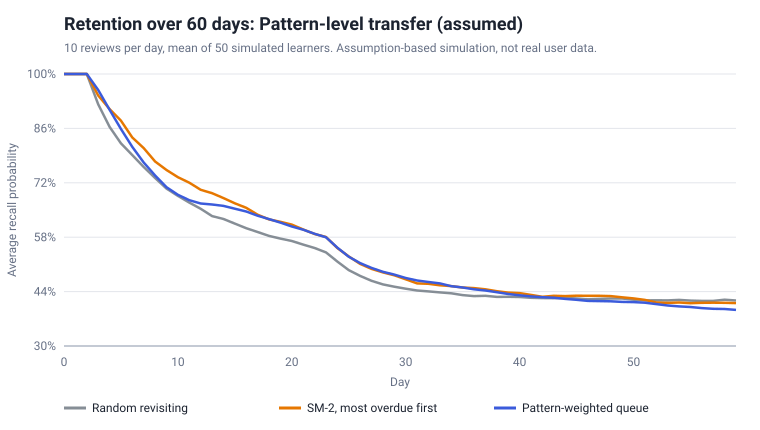
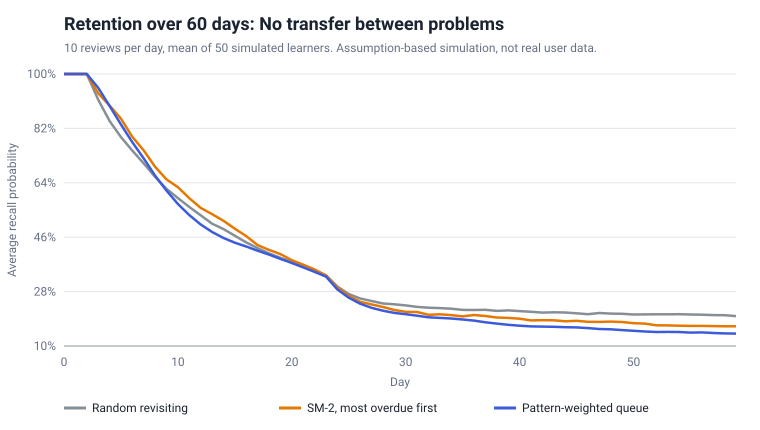

# Simulation results

_Generated by `simulation/src/run.ts`. Do not edit by hand; run `npm run sim` in `simulation/`._

Settings: 60 days, 12 patterns x 10 problems, 5 new problems per day, 10 reviews per day, 50 random seeds.
Metric: average recall probability across all problems, on days 30 to 59. Values are mean +/- standard error across seeds.

## Scenario: Pattern-level transfer (assumed) (transfer = 0.8)

| Strategy | Mean recall, last 30 days | Recall on final day |
|---|---|---|
| Random revisiting | 42.5% +/- 0.5% | 41.7% |
| SM-2, most overdue first | 43.2% +/- 0.7% | 41.0% |
| Pattern-weighted queue | 42.5% +/- 0.8% | 39.3% |

Pattern-weighted minus SM-2: **-0.62 percentage points** (standard error 0.38); pattern-weighted was ahead in **21 of 50** seeds.

## Scenario: No transfer between problems (transfer = 0)

| Strategy | Mean recall, last 30 days | Recall on final day |
|---|---|---|
| Random revisiting | 21.2% +/- 0.3% | 19.9% |
| SM-2, most overdue first | 18.5% +/- 0.3% | 16.5% |
| Pattern-weighted queue | 16.5% +/- 0.4% | 14.1% |

Pattern-weighted minus SM-2: **-1.99 percentage points** (standard error 0.28); pattern-weighted was ahead in **6 of 50** seeds.

